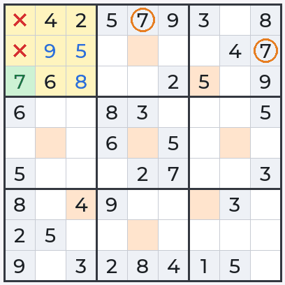

<!-- Written by tools/walkthrough.py asterisk: edit the script, not this page. -->
# Asterisk, step 4: the 7 in box 1

**Step 4 of 45** · [← Step 3](step-03.md) · [All steps](../asterisk.md#the-whole-puzzle-step-by-step) · [Step 5 →](step-05.md)

Box 1 needs a 7. r1c1: row 1 has one (r1c5). r2c1: row 2 has one (r2c9). Only **r3c1** is left: **r3c1 = 7**.

**Step 4 of 45** · [← Step 3](step-03.md) · [All steps](../asterisk.md#the-whole-puzzle-step-by-step) · [Step 5 →](step-05.md)
