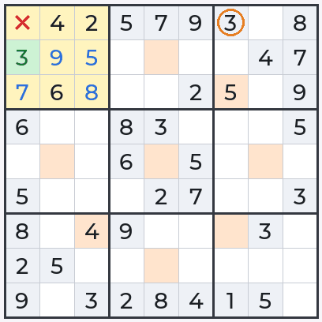

<!-- Written by tools/walkthrough.py asterisk: edit the script, not this page. -->
# Asterisk, step 5: the 3 in box 1

**Step 5 of 45** · [← Step 4](step-04.md) · [All steps](../asterisk.md#the-whole-puzzle-step-by-step) · [Step 6 →](step-06.md)

Box 1 needs a 3. r1c1: row 1 has one (r1c7). Only **r2c1** is left: **r2c1 = 3**.

**Step 5 of 45** · [← Step 4](step-04.md) · [All steps](../asterisk.md#the-whole-puzzle-step-by-step) · [Step 6 →](step-06.md)
