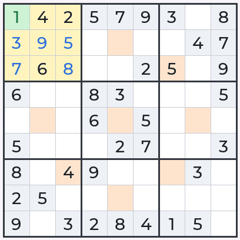

<!-- Written by tools/walkthrough.py asterisk: edit the script, not this page. -->
# Asterisk, step 6: the 1 in box 1

**Step 6 of 45** · [← Step 5](step-05.md) · [All steps](../asterisk.md#the-whole-puzzle-step-by-step) · [Step 7 →](step-07.md)

Box 1 needs a 1, and r1c1 is its last empty cell: **r1c1 = 1**.

**Step 6 of 45** · [← Step 5](step-05.md) · [All steps](../asterisk.md#the-whole-puzzle-step-by-step) · [Step 7 →](step-07.md)
