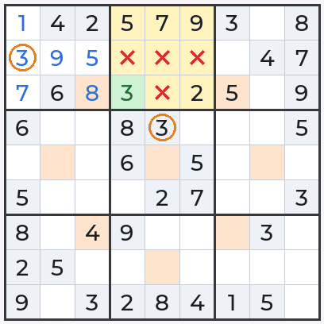

<!-- Written by tools/walkthrough.py asterisk: edit the script, not this page. -->
# Asterisk, step 7: the 3 in box 2

**Step 7 of 45** · [← Step 6](step-06.md) · [All steps](../asterisk.md#the-whole-puzzle-step-by-step) · [Step 8 →](step-08.md)

Box 2 needs a 3. r2c4, r2c5 and r2c6: row 2 has one (r2c1). r3c5: column 5 has one (r4c5). Only **r3c4** is left: **r3c4 = 3**.

**Step 7 of 45** · [← Step 6](step-06.md) · [All steps](../asterisk.md#the-whole-puzzle-step-by-step) · [Step 8 →](step-08.md)
