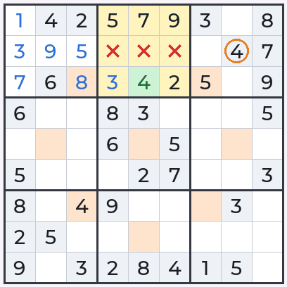

<!-- Written by tools/walkthrough.py asterisk: edit the script, not this page. -->
# Asterisk, step 8: the 4 in box 2

**Step 8 of 45** · [← Step 7](step-07.md) · [All steps](../asterisk.md#the-whole-puzzle-step-by-step) · [Step 9 →](step-09.md)

Box 2 needs a 4. r2c4, r2c5 and r2c6: row 2 has one (r2c8). Only **r3c5** is left: **r3c5 = 4**.

**Step 8 of 45** · [← Step 7](step-07.md) · [All steps](../asterisk.md#the-whole-puzzle-step-by-step) · [Step 9 →](step-09.md)
