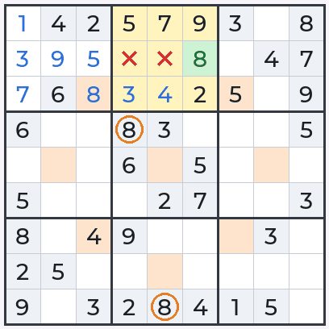

<!-- Written by tools/walkthrough.py asterisk: edit the script, not this page. -->
# Asterisk, step 9: the 8 in box 2

**Step 9 of 45** · [← Step 8](step-08.md) · [All steps](../asterisk.md#the-whole-puzzle-step-by-step) · [Step 10 →](step-10.md)

Box 2 needs an 8. r2c4: column 4 has one (r4c4). r2c5: column 5 has one (r9c5). Only **r2c6** is left: **r2c6 = 8**.

**Step 9 of 45** · [← Step 8](step-08.md) · [All steps](../asterisk.md#the-whole-puzzle-step-by-step) · [Step 10 →](step-10.md)
