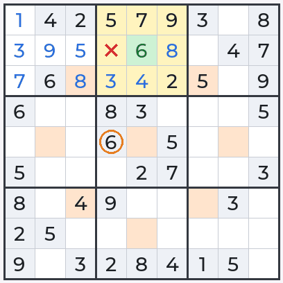

<!-- Written by tools/walkthrough.py asterisk: edit the script, not this page. -->
# Asterisk, step 10: the 6 in box 2

**Step 10 of 45** · [← Step 9](step-09.md) · [All steps](../asterisk.md#the-whole-puzzle-step-by-step) · [Step 11 →](step-11.md)

Box 2 needs a 6. r2c4: column 4 has one (r5c4). Only **r2c5** is left: **r2c5 = 6**.

**Step 10 of 45** · [← Step 9](step-09.md) · [All steps](../asterisk.md#the-whole-puzzle-step-by-step) · [Step 11 →](step-11.md)
