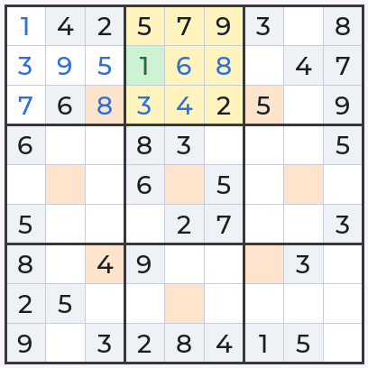

<!-- Written by tools/walkthrough.py asterisk: edit the script, not this page. -->
# Asterisk, step 11: the 1 in box 2

**Step 11 of 45** · [← Step 10](step-10.md) · [All steps](../asterisk.md#the-whole-puzzle-step-by-step) · [Step 12 →](step-12.md)

Box 2 needs a 1, and r2c4 is its last empty cell: **r2c4 = 1**.

**Step 11 of 45** · [← Step 10](step-10.md) · [All steps](../asterisk.md#the-whole-puzzle-step-by-step) · [Step 12 →](step-12.md)
