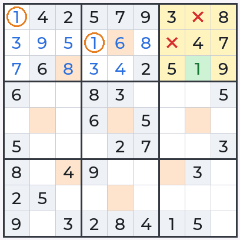

<!-- Written by tools/walkthrough.py asterisk: edit the script, not this page. -->
# Asterisk, step 12: the 1 in box 3

**Step 12 of 45** · [← Step 11](step-11.md) · [All steps](../asterisk.md#the-whole-puzzle-step-by-step) · [Step 13 →](step-13.md)

Box 3 needs a 1. r1c8: row 1 has one (r1c1). r2c7: row 2 has one (r2c4). Only **r3c8** is left: **r3c8 = 1**.

**Step 12 of 45** · [← Step 11](step-11.md) · [All steps](../asterisk.md#the-whole-puzzle-step-by-step) · [Step 13 →](step-13.md)
