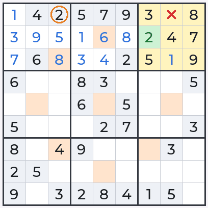

<!-- Written by tools/walkthrough.py asterisk: edit the script, not this page. -->
# Asterisk, step 13: the 2 in box 3

**Step 13 of 45** · [← Step 12](step-12.md) · [All steps](../asterisk.md#the-whole-puzzle-step-by-step) · [Step 14 →](step-14.md)

Box 3 needs a 2. r1c8: row 1 has one (r1c3). Only **r2c7** is left: **r2c7 = 2**.

**Step 13 of 45** · [← Step 12](step-12.md) · [All steps](../asterisk.md#the-whole-puzzle-step-by-step) · [Step 14 →](step-14.md)
