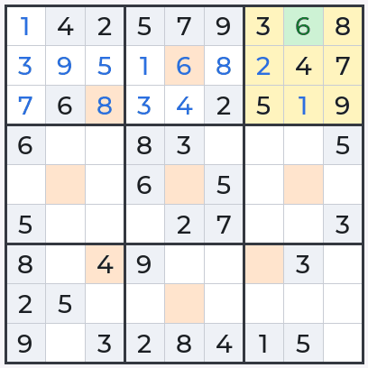

<!-- Written by tools/walkthrough.py asterisk: edit the script, not this page. -->
# Asterisk, step 14: the 6 in box 3

**Step 14 of 45** · [← Step 13](step-13.md) · [All steps](../asterisk.md#the-whole-puzzle-step-by-step) · [Step 15 →](step-15.md)

Box 3 needs a 6, and r1c8 is its last empty cell: **r1c8 = 6**.

**Step 14 of 45** · [← Step 13](step-13.md) · [All steps](../asterisk.md#the-whole-puzzle-step-by-step) · [Step 15 →](step-15.md)
