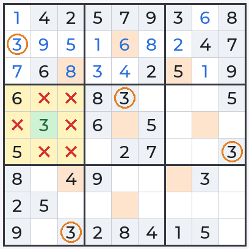

<!-- Written by tools/walkthrough.py asterisk: edit the script, not this page. -->
# Asterisk, step 15: the 3 in box 4

**Step 15 of 45** · [← Step 14](step-14.md) · [All steps](../asterisk.md#the-whole-puzzle-step-by-step) · [Step 16 →](step-16.md)

Box 4 needs a 3. r4c2 and r4c3: row 4 has one (r4c5). r5c1: column 1 has one (r2c1). r5c3: column 3 has one (r9c3). r6c2 and r6c3: row 6 has one (r6c9). Only **r5c2** is left: **r5c2 = 3**.

**Step 15 of 45** · [← Step 14](step-14.md) · [All steps](../asterisk.md#the-whole-puzzle-step-by-step) · [Step 16 →](step-16.md)
