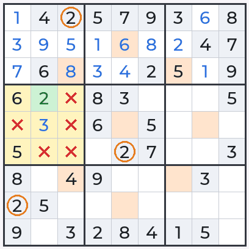

<!-- Written by tools/walkthrough.py asterisk: edit the script, not this page. -->
# Asterisk, step 16: the 2 in box 4

**Step 16 of 45** · [← Step 15](step-15.md) · [All steps](../asterisk.md#the-whole-puzzle-step-by-step) · [Step 17 →](step-17.md)

Box 4 needs a 2. r4c3 and r5c3: column 3 has one (r1c3). r5c1: column 1 has one (r8c1). r6c2 and r6c3: row 6 has one (r6c5). Only **r4c2** is left: **r4c2 = 2**.

**Step 16 of 45** · [← Step 15](step-15.md) · [All steps](../asterisk.md#the-whole-puzzle-step-by-step) · [Step 17 →](step-17.md)
