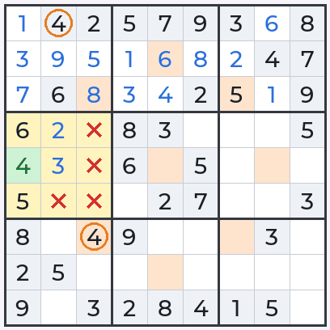

<!-- Written by tools/walkthrough.py asterisk: edit the script, not this page. -->
# Asterisk, step 17: the 4 in box 4

**Step 17 of 45** · [← Step 16](step-16.md) · [All steps](../asterisk.md#the-whole-puzzle-step-by-step) · [Step 18 →](step-18.md)

Box 4 needs a 4. r4c3, r5c3 and r6c3: column 3 has one (r7c3). r6c2: column 2 has one (r1c2). Only **r5c1** is left: **r5c1 = 4**.

**Step 17 of 45** · [← Step 16](step-16.md) · [All steps](../asterisk.md#the-whole-puzzle-step-by-step) · [Step 18 →](step-18.md)
