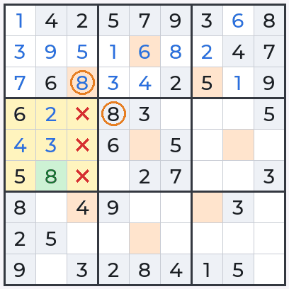

<!-- Written by tools/walkthrough.py asterisk: edit the script, not this page. -->
# Asterisk, step 18: the 8 in box 4

**Step 18 of 45** · [← Step 17](step-17.md) · [All steps](../asterisk.md#the-whole-puzzle-step-by-step) · [Step 19 →](step-19.md)

Box 4 needs an 8. r4c3: row 4 has one (r4c4). r5c3 and r6c3: column 3 has one (r3c3). Only **r6c2** is left: **r6c2 = 8**.

**Step 18 of 45** · [← Step 17](step-17.md) · [All steps](../asterisk.md#the-whole-puzzle-step-by-step) · [Step 19 →](step-19.md)
