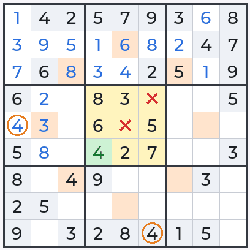

<!-- Written by tools/walkthrough.py asterisk: edit the script, not this page. -->
# Asterisk, step 19: the 4 in box 5

**Step 19 of 45** · [← Step 18](step-18.md) · [All steps](../asterisk.md#the-whole-puzzle-step-by-step) · [Step 20 →](step-20.md)

Box 5 needs a 4. r4c6: column 6 has one (r9c6). r5c5: row 5 has one (r5c1). Only **r6c4** is left: **r6c4 = 4**.

**Step 19 of 45** · [← Step 18](step-18.md) · [All steps](../asterisk.md#the-whole-puzzle-step-by-step) · [Step 20 →](step-20.md)
