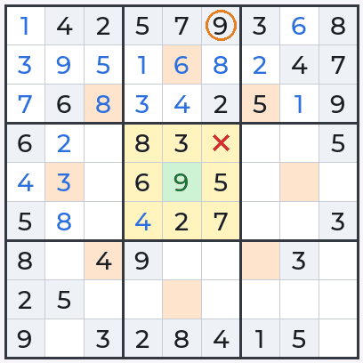

<!-- Written by tools/walkthrough.py asterisk: edit the script, not this page. -->
# Asterisk, step 20: the 9 in box 5

**Step 20 of 45** · [← Step 19](step-19.md) · [All steps](../asterisk.md#the-whole-puzzle-step-by-step) · [Step 21 →](step-21.md)

Box 5 needs a 9. r4c6: column 6 has one (r1c6). Only **r5c5** is left: **r5c5 = 9**.

**Step 20 of 45** · [← Step 19](step-19.md) · [All steps](../asterisk.md#the-whole-puzzle-step-by-step) · [Step 21 →](step-21.md)
