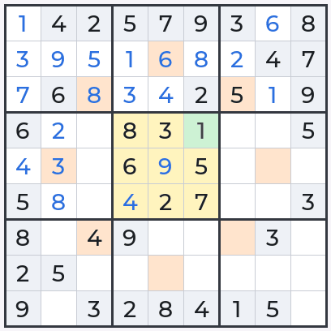

<!-- Written by tools/walkthrough.py asterisk: edit the script, not this page. -->
# Asterisk, step 21: the 1 in box 5

**Step 21 of 45** · [← Step 20](step-20.md) · [All steps](../asterisk.md#the-whole-puzzle-step-by-step) · [Step 22 →](step-22.md)

Box 5 needs a 1, and r4c6 is its last empty cell: **r4c6 = 1**.

**Step 21 of 45** · [← Step 20](step-20.md) · [All steps](../asterisk.md#the-whole-puzzle-step-by-step) · [Step 22 →](step-22.md)
