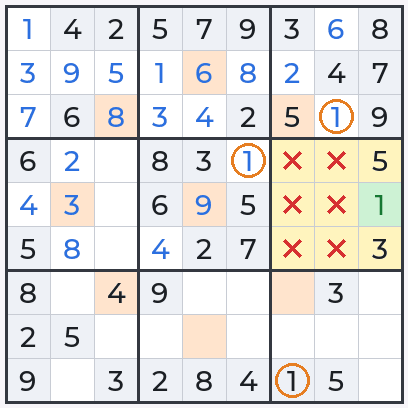

<!-- Written by tools/walkthrough.py asterisk: edit the script, not this page. -->
# Asterisk, step 22: the 1 in box 6

**Step 22 of 45** · [← Step 21](step-21.md) · [All steps](../asterisk.md#the-whole-puzzle-step-by-step) · [Step 23 →](step-23.md)

Box 6 needs a 1. r4c7 and r4c8: row 4 has one (r4c6). r5c7 and r6c7: column 7 has one (r9c7). r5c8 and r6c8: column 8 has one (r3c8). Only **r5c9** is left: **r5c9 = 1**.

**Step 22 of 45** · [← Step 21](step-21.md) · [All steps](../asterisk.md#the-whole-puzzle-step-by-step) · [Step 23 →](step-23.md)
