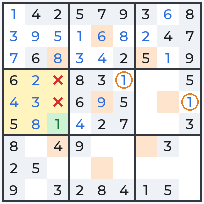

<!-- Written by tools/walkthrough.py asterisk: edit the script, not this page. -->
# Asterisk, step 23: the 1 in box 4

**Step 23 of 45** · [← Step 22](step-22.md) · [All steps](../asterisk.md#the-whole-puzzle-step-by-step) · [Step 24 →](step-24.md)

Box 4 needs a 1. r4c3: row 4 has one (r4c6). r5c3: row 5 has one (r5c9). Only **r6c3** is left: **r6c3 = 1**.

**Step 23 of 45** · [← Step 22](step-22.md) · [All steps](../asterisk.md#the-whole-puzzle-step-by-step) · [Step 24 →](step-24.md)
