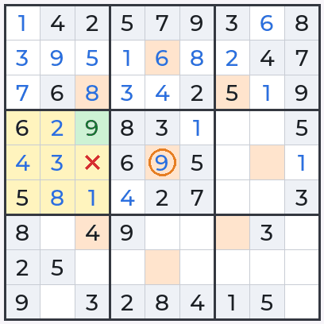

<!-- Written by tools/walkthrough.py asterisk: edit the script, not this page. -->
# Asterisk, step 24: the 9 in box 4

**Step 24 of 45** · [← Step 23](step-23.md) · [All steps](../asterisk.md#the-whole-puzzle-step-by-step) · [Step 25 →](step-25.md)

Box 4 needs a 9. r5c3: row 5 has one (r5c5). Only **r4c3** is left: **r4c3 = 9**.

**Step 24 of 45** · [← Step 23](step-23.md) · [All steps](../asterisk.md#the-whole-puzzle-step-by-step) · [Step 25 →](step-25.md)
