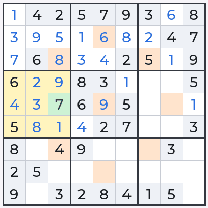

<!-- Written by tools/walkthrough.py asterisk: edit the script, not this page. -->
# Asterisk, step 25: the 7 in box 4

**Step 25 of 45** · [← Step 24](step-24.md) · [All steps](../asterisk.md#the-whole-puzzle-step-by-step) · [Step 26 →](step-26.md)

Box 4 needs a 7, and r5c3 is its last empty cell: **r5c3 = 7**.

**Step 25 of 45** · [← Step 24](step-24.md) · [All steps](../asterisk.md#the-whole-puzzle-step-by-step) · [Step 26 →](step-26.md)
