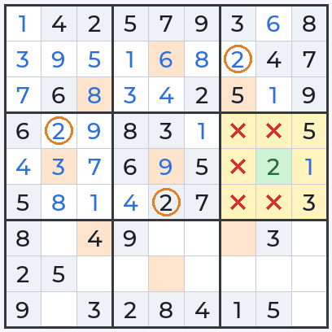

<!-- Written by tools/walkthrough.py asterisk: edit the script, not this page. -->
# Asterisk, step 26: the 2 in box 6

**Step 26 of 45** · [← Step 25](step-25.md) · [All steps](../asterisk.md#the-whole-puzzle-step-by-step) · [Step 27 →](step-27.md)

Box 6 needs a 2. r4c7 and r4c8: row 4 has one (r4c2). r5c7: column 7 has one (r2c7). r6c7 and r6c8: row 6 has one (r6c5). Only **r5c8** is left: **r5c8 = 2**.

**Step 26 of 45** · [← Step 25](step-25.md) · [All steps](../asterisk.md#the-whole-puzzle-step-by-step) · [Step 27 →](step-27.md)
