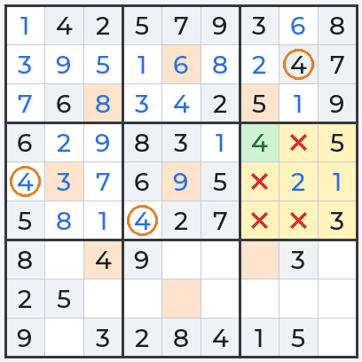

<!-- Written by tools/walkthrough.py asterisk: edit the script, not this page. -->
# Asterisk, step 27: the 4 in box 6

**Step 27 of 45** · [← Step 26](step-26.md) · [All steps](../asterisk.md#the-whole-puzzle-step-by-step) · [Step 28 →](step-28.md)

Box 6 needs a 4. r4c8: column 8 has one (r2c8). r5c7: row 5 has one (r5c1). r6c7 and r6c8: row 6 has one (r6c4). Only **r4c7** is left: **r4c7 = 4**.

**Step 27 of 45** · [← Step 26](step-26.md) · [All steps](../asterisk.md#the-whole-puzzle-step-by-step) · [Step 28 →](step-28.md)
