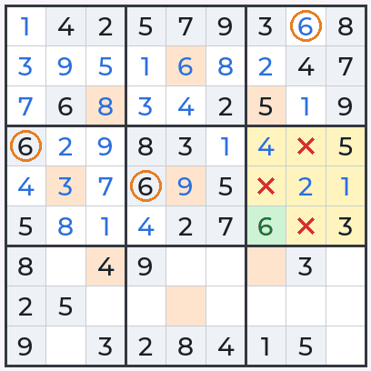

<!-- Written by tools/walkthrough.py asterisk: edit the script, not this page. -->
# Asterisk, step 28: the 6 in box 6

**Step 28 of 45** · [← Step 27](step-27.md) · [All steps](../asterisk.md#the-whole-puzzle-step-by-step) · [Step 29 →](step-29.md)

Box 6 needs a 6. r4c8: row 4 has one (r4c1). r5c7: row 5 has one (r5c4). r6c8: column 8 has one (r1c8). Only **r6c7** is left: **r6c7 = 6**.

**Step 28 of 45** · [← Step 27](step-27.md) · [All steps](../asterisk.md#the-whole-puzzle-step-by-step) · [Step 29 →](step-29.md)
