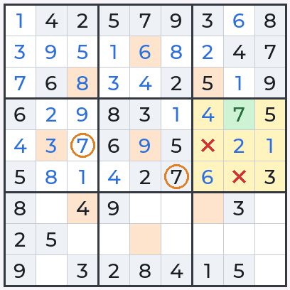

<!-- Written by tools/walkthrough.py asterisk: edit the script, not this page. -->
# Asterisk, step 29: the 7 in box 6

**Step 29 of 45** · [← Step 28](step-28.md) · [All steps](../asterisk.md#the-whole-puzzle-step-by-step) · [Step 30 →](step-30.md)

Box 6 needs a 7. r5c7: row 5 has one (r5c3). r6c8: row 6 has one (r6c6). Only **r4c8** is left: **r4c8 = 7**.

**Step 29 of 45** · [← Step 28](step-28.md) · [All steps](../asterisk.md#the-whole-puzzle-step-by-step) · [Step 30 →](step-30.md)
