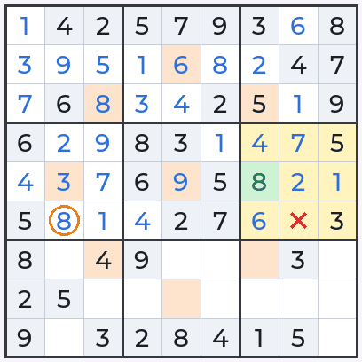

<!-- Written by tools/walkthrough.py asterisk: edit the script, not this page. -->
# Asterisk, step 30: the 8 in box 6

**Step 30 of 45** · [← Step 29](step-29.md) · [All steps](../asterisk.md#the-whole-puzzle-step-by-step) · [Step 31 →](step-31.md)

Box 6 needs an 8. r6c8: row 6 has one (r6c2). Only **r5c7** is left: **r5c7 = 8**.

**Step 30 of 45** · [← Step 29](step-29.md) · [All steps](../asterisk.md#the-whole-puzzle-step-by-step) · [Step 31 →](step-31.md)
