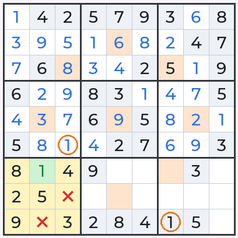

<!-- Written by tools/walkthrough.py asterisk: edit the script, not this page. -->
# Asterisk, step 32: the 1 in box 7

**Step 32 of 45** · [← Step 31](step-31.md) · [All steps](../asterisk.md#the-whole-puzzle-step-by-step) · [Step 33 →](step-33.md)

Box 7 needs a 1. r8c3: column 3 has one (r6c3). r9c2: row 9 has one (r9c7). Only **r7c2** is left: **r7c2 = 1**.

**Step 32 of 45** · [← Step 31](step-31.md) · [All steps](../asterisk.md#the-whole-puzzle-step-by-step) · [Step 33 →](step-33.md)
