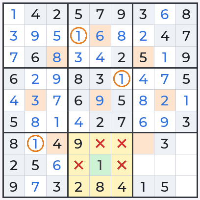

<!-- Written by tools/walkthrough.py asterisk: edit the script, not this page. -->
# Asterisk, step 35: the 1 in box 8

**Step 35 of 45** · [← Step 34](step-34.md) · [All steps](../asterisk.md#the-whole-puzzle-step-by-step) · [Step 36 →](step-36.md)

Box 8 needs a 1. r7c5 and r7c6: row 7 has one (r7c2). r8c4: column 4 has one (r2c4). r8c6: column 6 has one (r4c6). Only **r8c5** is left: **r8c5 = 1**.

**Step 35 of 45** · [← Step 34](step-34.md) · [All steps](../asterisk.md#the-whole-puzzle-step-by-step) · [Step 36 →](step-36.md)
