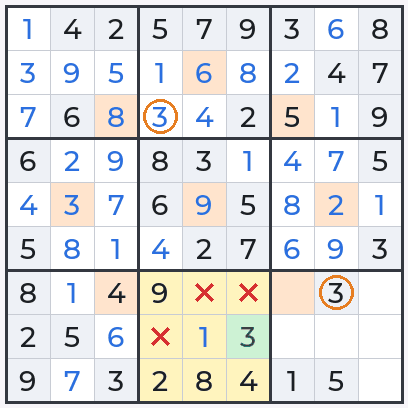

<!-- Written by tools/walkthrough.py asterisk: edit the script, not this page. -->
# Asterisk, step 36: the 3 in box 8

**Step 36 of 45** · [← Step 35](step-35.md) · [All steps](../asterisk.md#the-whole-puzzle-step-by-step) · [Step 37 →](step-37.md)

Box 8 needs a 3. r7c5 and r7c6: row 7 has one (r7c8). r8c4: column 4 has one (r3c4). Only **r8c6** is left: **r8c6 = 3**.

**Step 36 of 45** · [← Step 35](step-35.md) · [All steps](../asterisk.md#the-whole-puzzle-step-by-step) · [Step 37 →](step-37.md)
