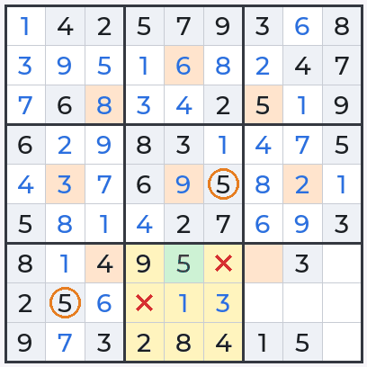

<!-- Written by tools/walkthrough.py asterisk: edit the script, not this page. -->
# Asterisk, step 37: the 5 in box 8

**Step 37 of 45** · [← Step 36](step-36.md) · [All steps](../asterisk.md#the-whole-puzzle-step-by-step) · [Step 38 →](step-38.md)

Box 8 needs a 5. r7c6: column 6 has one (r5c6). r8c4: row 8 has one (r8c2). Only **r7c5** is left: **r7c5 = 5**.

**Step 37 of 45** · [← Step 36](step-36.md) · [All steps](../asterisk.md#the-whole-puzzle-step-by-step) · [Step 38 →](step-38.md)
