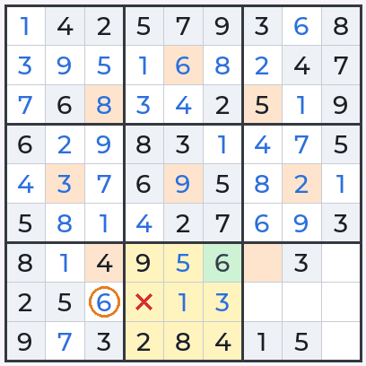

<!-- Written by tools/walkthrough.py asterisk: edit the script, not this page. -->
# Asterisk, step 38: the 6 in box 8

**Step 38 of 45** · [← Step 37](step-37.md) · [All steps](../asterisk.md#the-whole-puzzle-step-by-step) · [Step 39 →](step-39.md)

Box 8 needs a 6. r8c4: row 8 has one (r8c3). Only **r7c6** is left: **r7c6 = 6**.

**Step 38 of 45** · [← Step 37](step-37.md) · [All steps](../asterisk.md#the-whole-puzzle-step-by-step) · [Step 39 →](step-39.md)
