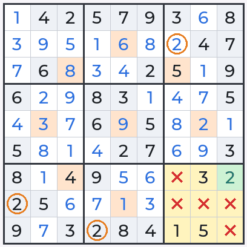

<!-- Written by tools/walkthrough.py asterisk: edit the script, not this page. -->
# Asterisk, step 40: the 2 in box 9

**Step 40 of 45** · [← Step 39](step-39.md) · [All steps](../asterisk.md#the-whole-puzzle-step-by-step) · [Step 41 →](step-41.md)

Box 9 needs a 2. r7c7: column 7 has one (r2c7). r8c7, r8c8 and r8c9: row 8 has one (r8c1). r9c9: row 9 has one (r9c4). Only **r7c9** is left: **r7c9 = 2**.

**Step 40 of 45** · [← Step 39](step-39.md) · [All steps](../asterisk.md#the-whole-puzzle-step-by-step) · [Step 41 →](step-41.md)
