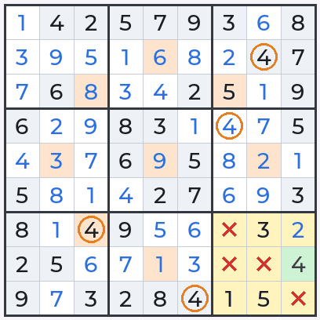

<!-- Written by tools/walkthrough.py asterisk: edit the script, not this page. -->
# Asterisk, step 41: the 4 in box 9

**Step 41 of 45** · [← Step 40](step-40.md) · [All steps](../asterisk.md#the-whole-puzzle-step-by-step) · [Step 42 →](step-42.md)

Box 9 needs a 4. r7c7: row 7 has one (r7c3). r8c7: column 7 has one (r4c7). r8c8: column 8 has one (r2c8). r9c9: row 9 has one (r9c6). Only **r8c9** is left: **r8c9 = 4**.

**Step 41 of 45** · [← Step 40](step-40.md) · [All steps](../asterisk.md#the-whole-puzzle-step-by-step) · [Step 42 →](step-42.md)
