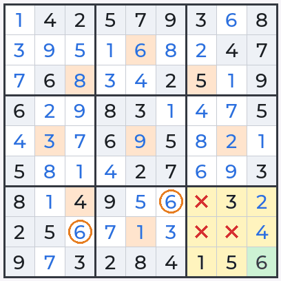

<!-- Written by tools/walkthrough.py asterisk: edit the script, not this page. -->
# Asterisk, step 42: the 6 in box 9

**Step 42 of 45** · [← Step 41](step-41.md) · [All steps](../asterisk.md#the-whole-puzzle-step-by-step) · [Step 43 →](step-43.md)

Box 9 needs a 6. r7c7: row 7 has one (r7c6). r8c7 and r8c8: row 8 has one (r8c3). Only **r9c9** is left: **r9c9 = 6**.

**Step 42 of 45** · [← Step 41](step-41.md) · [All steps](../asterisk.md#the-whole-puzzle-step-by-step) · [Step 43 →](step-43.md)
