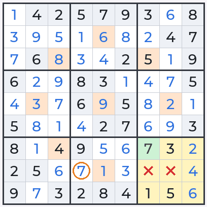

<!-- Written by tools/walkthrough.py asterisk: edit the script, not this page. -->
# Asterisk, step 43: the 7 in box 9

**Step 43 of 45** · [← Step 42](step-42.md) · [All steps](../asterisk.md#the-whole-puzzle-step-by-step) · [Step 44 →](step-44.md)

Box 9 needs a 7. r8c7 and r8c8: row 8 has one (r8c4). Only **r7c7** is left: **r7c7 = 7**.

**Step 43 of 45** · [← Step 42](step-42.md) · [All steps](../asterisk.md#the-whole-puzzle-step-by-step) · [Step 44 →](step-44.md)
