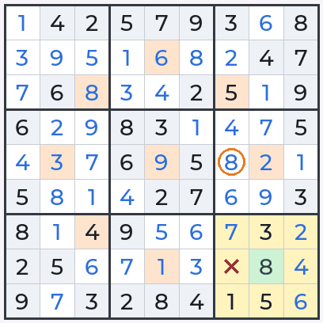

<!-- Written by tools/walkthrough.py asterisk: edit the script, not this page. -->
# Asterisk, step 44: the 8 in box 9

**Step 44 of 45** · [← Step 43](step-43.md) · [All steps](../asterisk.md#the-whole-puzzle-step-by-step) · [Step 45 →](step-45.md)

Box 9 needs an 8. r8c7: column 7 has one (r5c7). Only **r8c8** is left: **r8c8 = 8**.

**Step 44 of 45** · [← Step 43](step-43.md) · [All steps](../asterisk.md#the-whole-puzzle-step-by-step) · [Step 45 →](step-45.md)
