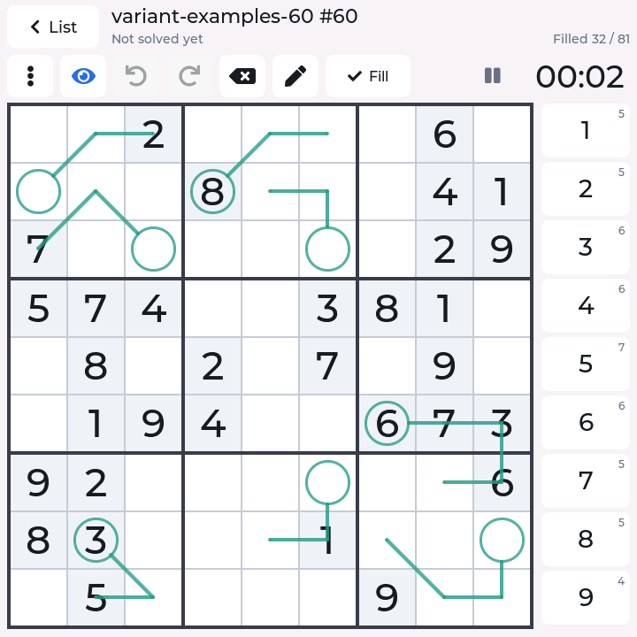
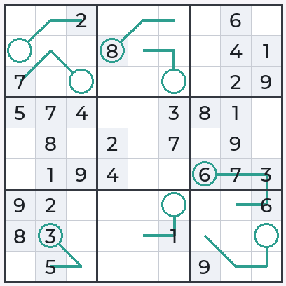

# Average Lines

[← All variants](README.md) · [Puzzles](../features-puzzles.md) · [How to play](../how-to-play.md)

## The rules

[Classic](classic.md) rules, and **teal lines with a circle at one end**: the digit in the circle is the **average** of the other digits on its line. So they add up to the circle times how many they are: a circle of 5 with three cells after it needs them to make 15 (3, 8, 4, for one). Digits may repeat along a line where the rules allow.

## On the board

- A teal ring marks the circle; the line runs from its edge through the other cells.
- With the circle filled, the line's digits turn red when the others can no longer make its average (too much, or too little even with 9s).
- The grader and hints: "The circled digit is the average of the other digits on its line, so row 2, column 1 can only be 3."
- **Puzzles → ⋮ → New puzzle → Lines → Average**: 8 lines (Hard and Expert: 10) of 3 to 6 cells.

## How to solve it

- **Two cells after the circle:** they make twice the circle, so a circle of 1 means two 1s (only where they don't see each other), and a 9 two 9s.
- **The circle is the middle:** it's between the line's smallest and largest other digit (or equal to all of them).
- **Count the cells:** with the others known but one, the last is the circle times the count less the rest.

## Worked example

**variant-examples #60**, Average Lines Easy (see [Classic](classic.md#worked-example-the-whole-puzzle) for how to import the examples; cells are written r*row*c*column*).

**Step 1: r2c1.** Row 2 has 1, 4 and 8; column 1 has 5, 7 and 9; box 1 has 2: that leaves 3 and 6. r2c1 is the circle of a line with r1c2 and the 2 in r1c3: those two make twice the circle, so a 6 would need r1c2 to be 10. **r2c1 = 3**.

**Step 2: r1c2.** Twice 3 is 6, and the 2 in r1c3 leaves 4. (Column 2 and row 1 leave it 4 or 9.) **r1c2 = 4**.

**Step 3: r1c6.** Its line has the circle 8 in r2c4 and r1c5: those two make 16. Column 6 and row 1 leave r1c6 5 or 9; a 5 would need r1c5 to be 11. **r1c6 = 9** (and r1c5 = 7).

## The whole puzzle, step by step

<!-- walkthrough -->
<!-- Written by tools/walkthrough.py average-lines: edit the script, not this part. -->

The whole puzzle, from the start to the last cell: 49 steps, each one a single (one place left for a digit, or one digit left for a cell), taken in the order a box's single comes first, so not quite the order of the worked example above. Each step has a page of its own, with **Previous** and **Next**: pick its number below. In each picture, the unit the step looks at is tinted yellow (for a cell with one digit left: its row, column and box), the new digit is on green, the digits that rule cells out have an **orange ring**, and the empty cells they rule out a **red cross**. Givens are on grey, digits from earlier steps in blue.

| [1](average-lines/step-01.md) | [2](average-lines/step-02.md) | [3](average-lines/step-03.md) | [4](average-lines/step-04.md) | [5](average-lines/step-05.md) | [6](average-lines/step-06.md) | [7](average-lines/step-07.md) | [8](average-lines/step-08.md) | [9](average-lines/step-09.md) | [10](average-lines/step-10.md) |
|:-:|:-:|:-:|:-:|:-:|:-:|:-:|:-:|:-:|:-:|
| [11](average-lines/step-11.md) | [12](average-lines/step-12.md) | [13](average-lines/step-13.md) | [14](average-lines/step-14.md) | [15](average-lines/step-15.md) | [16](average-lines/step-16.md) | [17](average-lines/step-17.md) | [18](average-lines/step-18.md) | [19](average-lines/step-19.md) | [20](average-lines/step-20.md) |
| [21](average-lines/step-21.md) | [22](average-lines/step-22.md) | [23](average-lines/step-23.md) | [24](average-lines/step-24.md) | [25](average-lines/step-25.md) | [26](average-lines/step-26.md) | [27](average-lines/step-27.md) | [28](average-lines/step-28.md) | [29](average-lines/step-29.md) | [30](average-lines/step-30.md) |
| [31](average-lines/step-31.md) | [32](average-lines/step-32.md) | [33](average-lines/step-33.md) | [34](average-lines/step-34.md) | [35](average-lines/step-35.md) | [36](average-lines/step-36.md) | [37](average-lines/step-37.md) | [38](average-lines/step-38.md) | [39](average-lines/step-39.md) | [40](average-lines/step-40.md) |
| [41](average-lines/step-41.md) | [42](average-lines/step-42.md) | [43](average-lines/step-43.md) | [44](average-lines/step-44.md) | [45](average-lines/step-45.md) | [46](average-lines/step-46.md) | [47](average-lines/step-47.md) | [48](average-lines/step-48.md) | [49](average-lines/step-49.md) |  |

Solved.

<!-- /walkthrough -->
