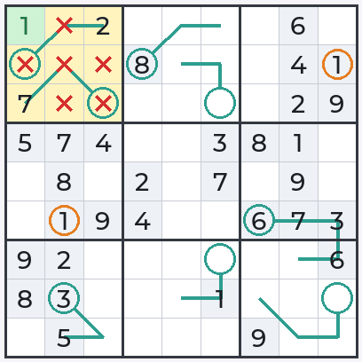

<!-- Written by tools/walkthrough.py average-lines: edit the script, not this page. -->
# Average Lines, step 1: the 1 in box 1

**Step 1 of 49** · [← The start](../average-lines.md#the-whole-puzzle-step-by-step) · [All steps](../average-lines.md#the-whole-puzzle-step-by-step) · [Step 2 →](step-02.md)

Box 1 needs a 1. r1c2 and r3c2: column 2 has one (r6c2). r2c1, r2c2 and r2c3: row 2 has one (r2c9). r3c3: it's the circle, and 2 times 1 is out of reach of the line's other 2 cells. Only **r1c1** is left: **r1c1 = 1**.

**Step 1 of 49** · [← The start](../average-lines.md#the-whole-puzzle-step-by-step) · [All steps](../average-lines.md#the-whole-puzzle-step-by-step) · [Step 2 →](step-02.md)
