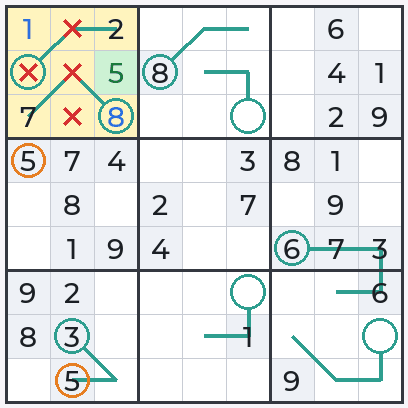

<!-- Written by tools/walkthrough.py average-lines: edit the script, not this page. -->
# Average Lines, step 3: the 5 in box 1

**Step 3 of 49** · [← Step 2](step-02.md) · [All steps](../average-lines.md#the-whole-puzzle-step-by-step) · [Step 4 →](step-04.md)

Box 1 needs a 5. r1c2, r2c2 and r3c2: column 2 has one (r9c2). r2c1: column 1 has one (r4c1). Only **r2c3** is left: **r2c3 = 5**.

**Step 3 of 49** · [← Step 2](step-02.md) · [All steps](../average-lines.md#the-whole-puzzle-step-by-step) · [Step 4 →](step-04.md)
