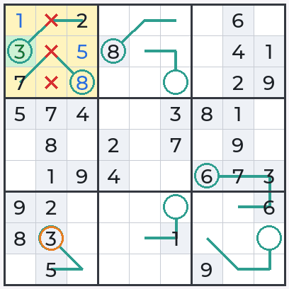

<!-- Written by tools/walkthrough.py average-lines: edit the script, not this page. -->
# Average Lines, step 4: the 3 in box 1

**Step 4 of 49** · [← Step 3](step-03.md) · [All steps](../average-lines.md#the-whole-puzzle-step-by-step) · [Step 5 →](step-05.md)

Box 1 needs a 3. r1c2, r2c2 and r3c2: column 2 has one (r8c2). Only **r2c1** is left: **r2c1 = 3**.

**Step 4 of 49** · [← Step 3](step-03.md) · [All steps](../average-lines.md#the-whole-puzzle-step-by-step) · [Step 5 →](step-05.md)
