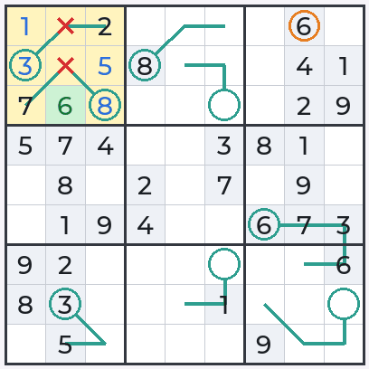

<!-- Written by tools/walkthrough.py average-lines: edit the script, not this page. -->
# Average Lines, step 5: the 6 in box 1

**Step 5 of 49** · [← Step 4](step-04.md) · [All steps](../average-lines.md#the-whole-puzzle-step-by-step) · [Step 6 →](step-06.md)

Box 1 needs a 6. r1c2: row 1 has one (r1c8). r2c2: the circle 8 times its 2 other cells is 16, and the rest make 7, so it's 9. Only **r3c2** is left: **r3c2 = 6**.

**Step 5 of 49** · [← Step 4](step-04.md) · [All steps](../average-lines.md#the-whole-puzzle-step-by-step) · [Step 6 →](step-06.md)
