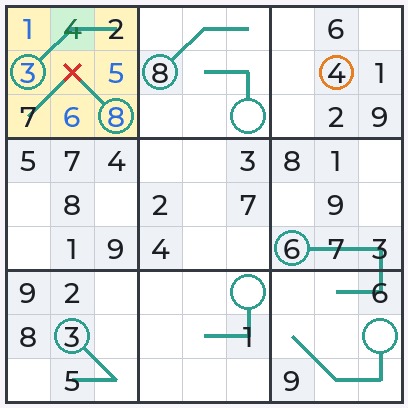

<!-- Written by tools/walkthrough.py average-lines: edit the script, not this page. -->
# Average Lines, step 6: the 4 in box 1

**Step 6 of 49** · [← Step 5](step-05.md) · [All steps](../average-lines.md#the-whole-puzzle-step-by-step) · [Step 7 →](step-07.md)

Box 1 needs a 4. r2c2: row 2 has one (r2c8). Only **r1c2** is left: **r1c2 = 4**.

**Step 6 of 49** · [← Step 5](step-05.md) · [All steps](../average-lines.md#the-whole-puzzle-step-by-step) · [Step 7 →](step-07.md)
