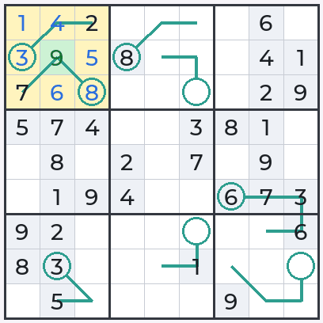

<!-- Written by tools/walkthrough.py average-lines: edit the script, not this page. -->
# Average Lines, step 7: the 9 in box 1

**Step 7 of 49** · [← Step 6](step-06.md) · [All steps](../average-lines.md#the-whole-puzzle-step-by-step) · [Step 8 →](step-08.md)

Box 1 needs a 9, and r2c2 is its last empty cell: **r2c2 = 9**.

**Step 7 of 49** · [← Step 6](step-06.md) · [All steps](../average-lines.md#the-whole-puzzle-step-by-step) · [Step 8 →](step-08.md)
