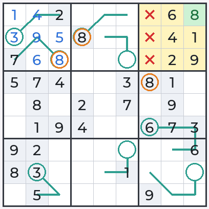

<!-- Written by tools/walkthrough.py average-lines: edit the script, not this page. -->
# Average Lines, step 8: the 8 in box 3

**Step 8 of 49** · [← Step 7](step-07.md) · [All steps](../average-lines.md#the-whole-puzzle-step-by-step) · [Step 9 →](step-09.md)

Box 3 needs an 8. r1c7: column 7 has one (r4c7). r2c7: row 2 has one (r2c4). r3c7: row 3 has one (r3c3). Only **r1c9** is left: **r1c9 = 8**.

**Step 8 of 49** · [← Step 7](step-07.md) · [All steps](../average-lines.md#the-whole-puzzle-step-by-step) · [Step 9 →](step-09.md)
