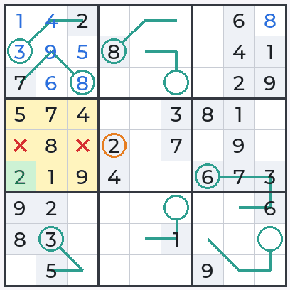

<!-- Written by tools/walkthrough.py average-lines: edit the script, not this page. -->
# Average Lines, step 9: the 2 in box 4

**Step 9 of 49** · [← Step 8](step-08.md) · [All steps](../average-lines.md#the-whole-puzzle-step-by-step) · [Step 10 →](step-10.md)

Box 4 needs a 2. r5c1 and r5c3: row 5 has one (r5c4). Only **r6c1** is left: **r6c1 = 2**.

**Step 9 of 49** · [← Step 8](step-08.md) · [All steps](../average-lines.md#the-whole-puzzle-step-by-step) · [Step 10 →](step-10.md)
