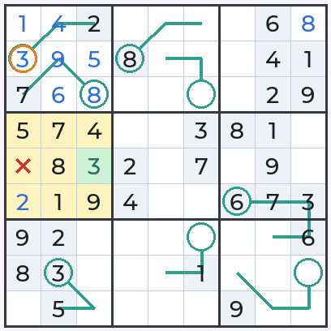

<!-- Written by tools/walkthrough.py average-lines: edit the script, not this page. -->
# Average Lines, step 10: the 3 in box 4

**Step 10 of 49** · [← Step 9](step-09.md) · [All steps](../average-lines.md#the-whole-puzzle-step-by-step) · [Step 11 →](step-11.md)

Box 4 needs a 3. r5c1: column 1 has one (r2c1). Only **r5c3** is left: **r5c3 = 3**.

**Step 10 of 49** · [← Step 9](step-09.md) · [All steps](../average-lines.md#the-whole-puzzle-step-by-step) · [Step 11 →](step-11.md)
