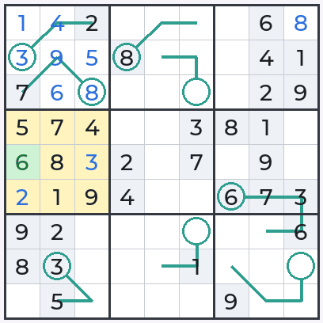

<!-- Written by tools/walkthrough.py average-lines: edit the script, not this page. -->
# Average Lines, step 11: the 6 in box 4

**Step 11 of 49** · [← Step 10](step-10.md) · [All steps](../average-lines.md#the-whole-puzzle-step-by-step) · [Step 12 →](step-12.md)

Box 4 needs a 6, and r5c1 is its last empty cell: **r5c1 = 6**.

**Step 11 of 49** · [← Step 10](step-10.md) · [All steps](../average-lines.md#the-whole-puzzle-step-by-step) · [Step 12 →](step-12.md)
