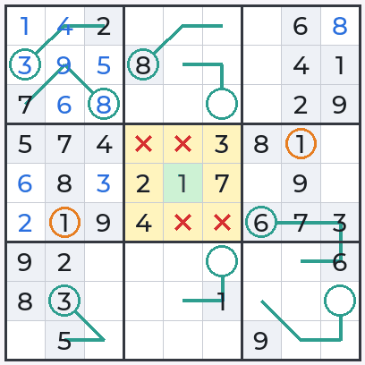

<!-- Written by tools/walkthrough.py average-lines: edit the script, not this page. -->
# Average Lines, step 12: the 1 in box 5

**Step 12 of 49** · [← Step 11](step-11.md) · [All steps](../average-lines.md#the-whole-puzzle-step-by-step) · [Step 13 →](step-13.md)

Box 5 needs a 1. r4c4 and r4c5: row 4 has one (r4c8). r6c5 and r6c6: row 6 has one (r6c2). Only **r5c5** is left: **r5c5 = 1**.

**Step 12 of 49** · [← Step 11](step-11.md) · [All steps](../average-lines.md#the-whole-puzzle-step-by-step) · [Step 13 →](step-13.md)
