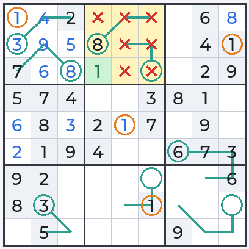

<!-- Written by tools/walkthrough.py average-lines: edit the script, not this page. -->
# Average Lines, step 13: the 1 in box 2

**Step 13 of 49** · [← Step 12](step-12.md) · [All steps](../average-lines.md#the-whole-puzzle-step-by-step) · [Step 14 →](step-14.md)

Box 2 needs a 1. r1c4, r1c5 and r1c6: row 1 has one (r1c1). r2c5 and r2c6: row 2 has one (r2c9). r3c5: column 5 has one (r5c5). r3c6: column 6 has one (r8c6). Only **r3c4** is left: **r3c4 = 1**.

**Step 13 of 49** · [← Step 12](step-12.md) · [All steps](../average-lines.md#the-whole-puzzle-step-by-step) · [Step 14 →](step-14.md)
